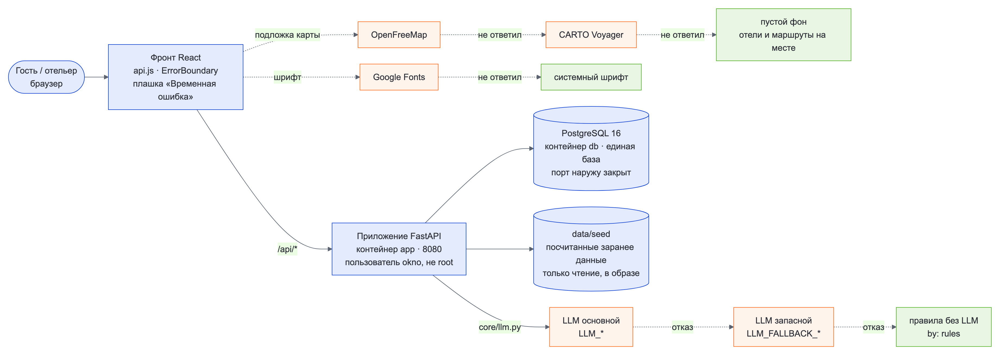
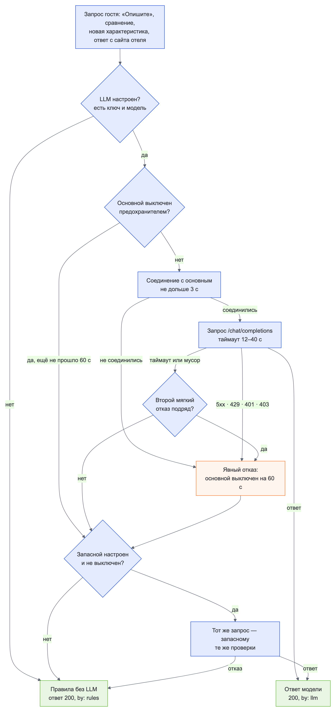
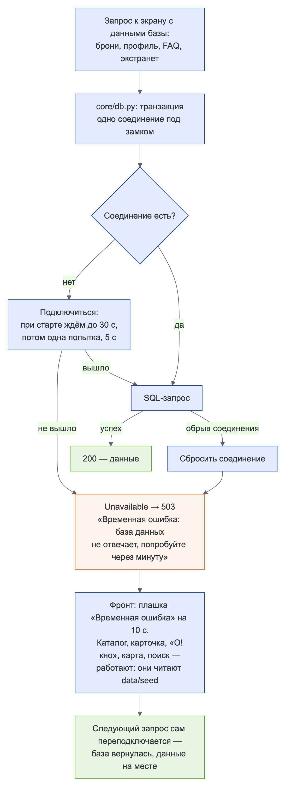
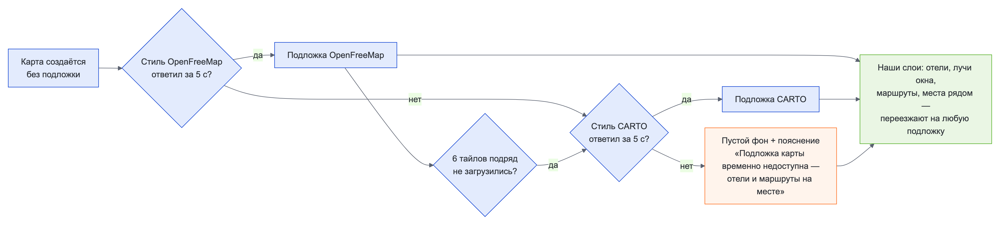

# Отказоустойчивость: что будет, если ляжет внешний API

Дата проверки: 28.10.2026. Стенд: `docker compose up --build` (app + PostgreSQL 16), порт 8090 для теста.

## 1. Все внешние зависимости во время работы сервиса

Искали все сетевые вызовы: `urlopen`, `Request`, `http(s)://` в `core/`, `app/`, `features/*/backend`, `features/*/frontend`.
Скрипты в `features/*/pipeline/` (Overpass, Copernicus DEM, обход сайтов отелей) работают **только офлайн**: их результат уже лежит в `data/seed`
и вшит в образ. Во время работы сервиса они не вызываются.

| # | Зависимость | Где используется | Было, если она ляжет | Стало |
|---|---|---|---|---|
| 1 | **LLM** (OpenAI-совместимый, AITunnel `qwen3.7-flash`) | «Опишите поездку», своё сравнение, новая характеристика описанием, ответ по тексту сайта отеля (FAQ) | Второго провайдера нет. Каждый запрос ждал полный таймаут **15–40 с**, потом отвечал правилами. Два модуля (`describe.py`, `from_text.py`) ходили в LLM напрямую, мимо общего клиента. Отказ LLM кешировался в ответах по сайтам до перезапуска | Основной → **запасной** (`LLM_FALLBACK_*`) → правила. Предохранитель: упавший провайдер 60 с не трогаем. Соединение проверяем за 3 с. Все вызовы идут через `core/llm.py`. Отказ не кешируется |
| 2 | **База данных** | брони, «Так и было?», отзывы, вопросы отелю, база знаний, добавленные характеристики | 4 файла SQLite + YAML/JSON внутри контейнера приложения | Единая PostgreSQL 16 (см. [02-database.md](02-database.md)). Не отвечает → **503 «Временная ошибка»** только на экранах с базой, остальное работает. Сервис переподключается сам |
| 3 | **Подложка карты** OpenFreeMap | карта | Стиль не загрузился → карта пустая, **точки отелей не появлялись** (наши слои добавлялись только после загрузки стиля) | OpenFreeMap → **CARTO Voyager** → пустой фон с пояснением. Отели, лучи окна и маршруты видны всегда |
| 4 | Google Fonts | шрифт Manrope | — | В CSS уже стоит `Manrope, system-ui, sans-serif`: подставится системный шрифт. Менять не нужно |
| 5 | Фото мест, данные отелей, «О!кно», шум, POI | карточка, город | — | Локальные файлы `data/seed` в образе, внешних вызовов нет |

## 2. LLM: переключение на второй API

Правила (`core/llm.py`):
- **Явный отказ** выключает провайдера на 60 с сразу: не соединились за 3 с, DNS, ответ 5xx, 429 (лимит), 401/403 (ключ).
- **Мягкий отказ** (таймаут ответа, ответ не JSON) выключает провайдера только со второго раза подряд. Один медленный ответ не должен выключать LLM для всех гостей.
- Тот же запрос гостя сразу уходит запасному. Не ответил и он — фича отвечает правилами (`by: rules`). Гость получает ответ всегда.
- Прошло 60 с — провайдер снова в строю. Состояние без ключей и адресов видно на `GET /health/deps`.
- Запасной провайдер задаётся необязательными `LLM_FALLBACK_BASE_URL`, `LLM_FALLBACK_API_KEY`, `LLM_FALLBACK_MODEL` в `.env`. Без них работают основной провайдер и правила.

### Автотест на поддельных провайдерах — `tests/scripts/test_llm_failover.py`

Два локальных OpenAI-совместимых сервера; поведение задаём на лету. Ключ не нужен и не тратится.

| Сценарий | Кто ответил | Время |
|---|---|---|
| 1. Оба живы | основной | 0.0 с |
| 2. Основной 500 | запасной (тот же запрос) | 0.0 с |
| 3. Основной выключен предохранителем | запасной, без ожидания | 0.0 с |
| 4. Основной 429 (лимит) | запасной | 0.0 с |
| 5. Основной один раз не уложился в таймаут | запасной; основной **не** выключен | 1.0 с |
| 6. Второй таймаут подряд | запасной; основной выключен, дальше 0.0 с | 1.0 с |
| 7. Основной вернул мусор вместо JSON | запасной | 0.0 с |
| 8. Оба 500 | правила | 0.0 с |
| 9. Оба выключены | правила, мгновенно, без сетевых запросов | 0.0 с |
| 10. Прошло 60 с, основной ожил | основной | 0.0 с |
| 11. Хост основного не отвечает (соединение висит) | запасной за 3 с, дальше 0.0 с | 3.0 с |

**Итог: 13 из 13 проверок пройдены.**

### Живой тест в Docker

Основной провайдер — несуществующий адрес `10.255.255.1`, запасной — настоящий AITunnel (ключ из `.env`, никуда не выводился).

| Запрос | До правок | После |
|---|---|---|
| `POST /api/describe` «тихий номер с видом на море в мае» | 200 за **15.1 с**, правила | 200 за **6.8 с**, ответ LLM (запасной) |
| `POST /api/describe` «хочу смотреть закат из окна» | 200 за 15.1 с, правила | 200 за 10.2 с, ответ LLM (запасной) |
| `POST /api/characteristics/from-text` | 200 за **40.1 с**, правила | ответ LLM через запасной |
| `POST /api/compare/custom` | 200 за 20.1 с, правила | 200 за 21.9 с, ответ LLM (запасной) |

В логе приложения: `LLM main не ответила (Unreachable), пробую запасную`. Если запасной сам не укладывается в таймаут фичи
(у «Опишите» он 15 с), гость получает ответ правилами, а не ошибку.

## 3. База данных недоступна

Тест: `docker compose stop db` на работающем сервисе.

| Запрос | Код | Время |
|---|---|---|
| `/health` | 200 | 0.0 с |
| `/api/hotels`, `/api/hotels/{id}`, `/window`, `/facts`, `/day`, `/sights`, `POST /api/search` | **200** | 0.0–0.1 с |
| `/api/bookings`, `/api/hotels/{id}/faq`, `/api/hotelier/{id}`, `/api/profile` | **503** «Временная ошибка: база данных не отвечает, попробуйте через минуту» | 0.0–1.5 с |
| `/health/deps` | 200, `"db": {"up": false}` | 0.0 с |

В браузере: каталог, карточка отеля, карта и «О!кно» работают, сверху плашка «Временная ошибка: часть данных не загрузилась. Попробуйте через минуту».
После `docker compose start db` все четыре экрана снова отвечают 200 **без перезапуска приложения**, данные на месте (3 брони до и после).

Старт: приложение ждёт healthcheck базы (`depends_on: condition: service_healthy`). Если база всё же не готова, первое подключение ждёт ещё до 30 с.
Оба контейнера с `restart: unless-stopped`.

## 4. Подложка карты недоступна

Проверено в браузере: подменили загрузку стиля OpenFreeMap на ошибку и пересоздали карту.
- OpenFreeMap недоступен → подложка CARTO Voyager, точки отелей, лучи окна и легенда на месте.
- Недоступны оба → серый фон, отели и лучи видны, справа внизу «Подложка карты временно недоступна — отели и маршруты на месте».

Первая версия переключения выбирала подложку по событию `error` карты и не работала: на одну неудачную загрузку MapLibre шлёт несколько таких событий.
Карта проскакивала CARTO и оставалась без точек. Исправлено: сначала проверяем, какой стиль отвечает, потом создаём карту. Повторная проверка пройдена.

## 5. Ошибки на фронте

- `app/frontend/api.js`: сеть или ответ 5xx → событие `api-down` → плашка «Временная ошибка» на 10 с. Ответы 4xx — штатные («такого нет»), о них не шумим.
- `app/frontend/ErrorBoundary.jsx`: ошибка отрисовки в одном блоке (панель, карта, профиль, город, сравнение) показывает «Временная ошибка — этот блок не загрузился. Остальное работает» с кнопкой «Попробовать ещё раз».
  Раньше любая такая ошибка давала белый экран. Корень приложения тоже обёрнут.

## Что остаётся (осознанно)

- Одна копия приложения и одна база — для демо этого достаточно; репликации Postgres нет.
- Если на старте база не поднялась за 30 с, характеристики, добавленные описанием, подгрузятся только после перезапуска приложения
  (остальные данные читаются при каждом запросе).
- Переключение подложки по ошибкам тайлов (стиль ответил, а тайлы нет) проверено только по коду; в браузере проверен отказ стиля.
