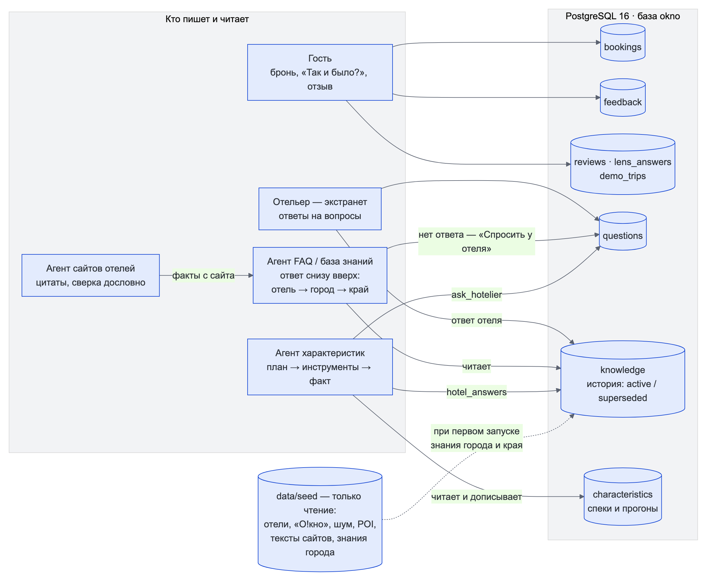

# Единая база данных



## Было

| Хранилище | Что | Где |
|---|---|---|
| `trip.db` (SQLite) | брони, ответы «Так и было?» | файл внутри контейнера app |
| `profile.db` (SQLite) | отзывы, ответы по фильтрам, демо-поездки | файл внутри контейнера app |
| `knowledge.db` (SQLite) | ответы отелей в базе знаний | файл внутри контейнера app |
| `hotelier.db` (SQLite) | очередь вопросов отелю | файл внутри контейнера app |
| `characteristics/*.yaml`, `*.json` | характеристики, добавленные описанием, и их прогоны | файлы внутри контейнера app |

Пять раздельных хранилищ. Агенты (FAQ, характеристики) писали в разные файлы. Знания города и края — только из JSON.
Шаблон README организаторов предполагает Postgres 16 сервисом `db` и переменную `DB_URL` (`raw/organizers/tech_rules.md`).

## Стало

- `docker-compose.yml`: сервис `db` — `postgres:16.6-alpine`, healthcheck `pg_isready`. Порт наружу **не проброшен**.
  У app: `DB_URL=postgresql://okno:…@db:5432/okno`, `depends_on: service_healthy`.
- `core/db.py` — один слой для всех фич: транзакции, переподключение, `Unavailable` → 503.
  Без `DB_URL` (запуск без Docker, тесты) — тот же SQL в одном файле SQLite `data/runtime/okno.db`. Это тоже одна база, а не пять.
- Все 8 таблиц в одной базе `okno`:

| Таблица | Пишет | Читает |
|---|---|---|
| `bookings` | гость (бронь), отель (ответ на пожелание) | профиль, экстранет, «Моя поездка» |
| `feedback` | гость («Так и было?») | пересчёт доверия к фактам |
| `reviews`, `lens_answers`, `demo_trips` | гость, демо при старте | профиль, отзывы в карточке |
| `questions` | гость («Спросить у отеля»), агент характеристик (`ask_hotelier`) | экстранет |
| `knowledge` | отельер (ответ), при первом запуске — знания города и края из `data/seed/knowledge.json` | агент FAQ (ответ снизу вверх: отель → город → край → страна), агент характеристик (`hotel_answers`) |
| `characteristics` | агент характеристик: спека и результаты прогона | агент характеристик при старте, фильтры поиска |

Новая запись знаний по той же теме не стирает старую: старая становится `superseded`, а новая `active` в одной транзакции.
История сохраняется.

`data/seed` остаётся файлами только для чтения: это заранее посчитанные расчёты (вид из окна по DEM, шум, граф пешеходных путей, POI, тексты сайтов).
Они версионируются в git вместе с кодом, который их считает, и не меняются во время работы. Переносить их в таблицы смысла нет.

## Проверки

| Проверка | Результат |
|---|---|
| Сборка `docker compose up --build`: оба контейнера `healthy` | ✅ |
| `/health/deps` → `{"db": {"kind": "postgresql", "up": true}}` | ✅ |
| `\dt` в базе: 8 таблиц `bookings, characteristics, demo_trips, feedback, knowledge, lens_answers, questions, reviews` | ✅ |
| Бронь `POST /api/bookings` → строка в `bookings` | ✅ 200 |
| «Спросить у отеля» дважды по одной теме → один вопрос, `demand` 1 → 2 | ✅ |
| Ответ отельера → запись в `knowledge`, FAQ отеля отвечает с уровня `hotel` | ✅ |
| Туристический налог в FAQ — с уровня `city`, из таблицы | ✅ |
| Характеристика описанием: создать → прогон по 696 отелям → строка в `characteristics` (спека 721 Б, прогон 310 КБ) → удалить → 0 строк | ✅ (SQLite-режим) |
| Перезапуск app на заполненной базе — демо не дублируется (3 брони, 10 отзывов, 114 ответов, 23 знания, 2 демо-поездки до и после) | ✅ |
| Остановка и запуск `db` — данные на месте, приложение переподключилось само | ✅ |
| Символ NUL в тексте (фаззинг): Postgres его не хранит → было 500, теперь вырезаем в `core/db.py` | ✅ исправлено |
| SQL только с плейсхолдерами `?`; единственный f-string собирает список колонок из констант | ✅ инъекций нет |

## Как посмотреть базу

```bash
docker compose exec db psql -U okno -d okno -c "\dt"
```
