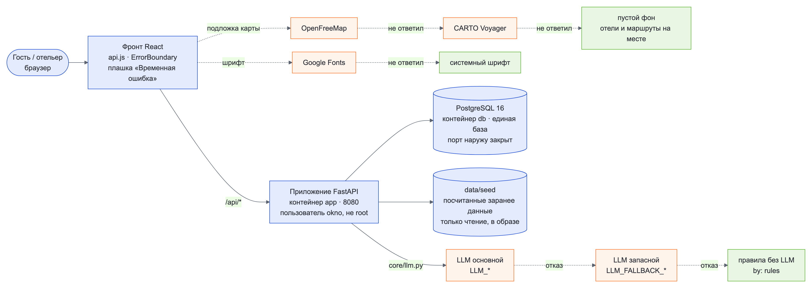
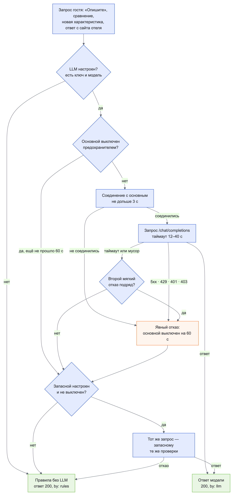
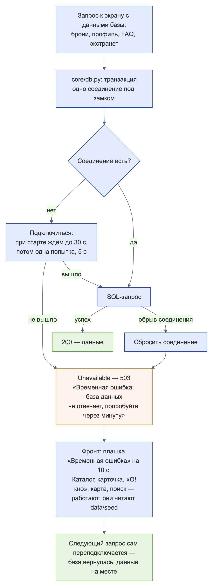
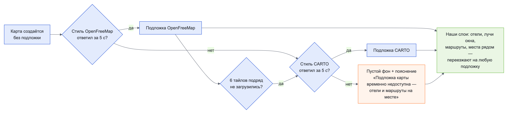
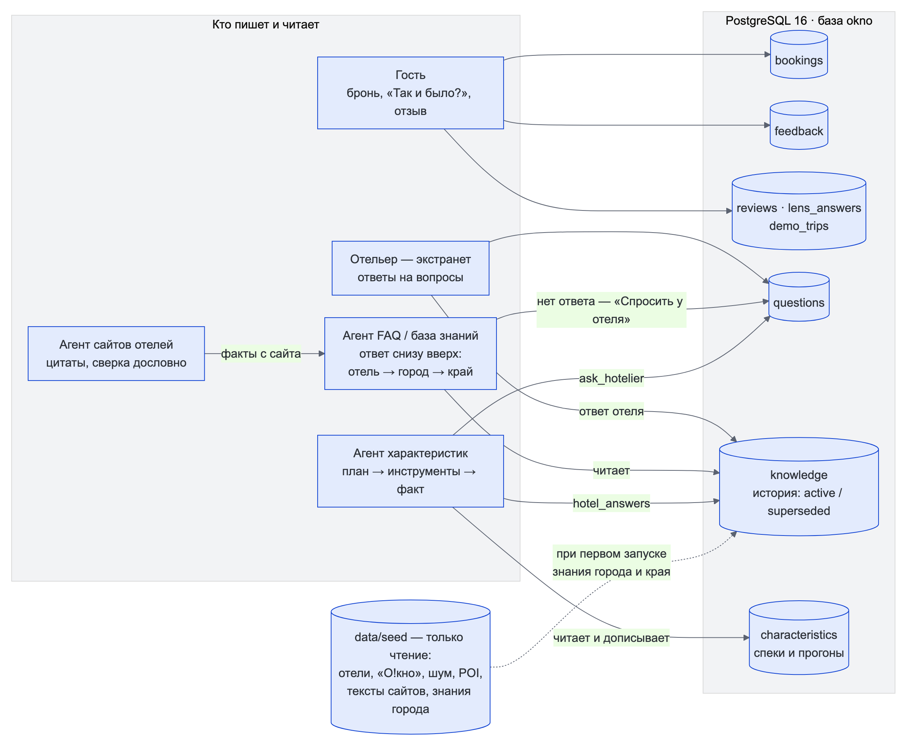

# Проверки «О!кна»: отказоустойчивость, база, безопасность

Аудит 28.10.2026: что ломается, если откажет внешний API или база, и есть ли риск утечек.
Найденные проблемы исправлены в коде, затем всё проверено заново на `docker compose up --build`.

## Итог

| Требование | Было | Стало | Статус |
|---|---|---|---|
| Единая база, PostgreSQL; агенты берут из неё данные и дописывают | 4 файла SQLite + YAML/JSON в контейнере приложения | PostgreSQL 16 (сервис `db`), 8 таблиц в одной базе, общий слой `core/db.py` | ✅ |
| Отказ одного внешнего API не роняет программу, в идеале — переключение на второй | LLM: второго провайдера нет, каждый запрос ждал 15–40 с. Карта: без стиля не было даже точек отелей | LLM: основной → запасной → правила, предохранитель, проверка соединения за 3 с. Карта: OpenFreeMap → CARTO → пустой фон | ✅ |
| Хотя бы «Временная ошибка» | База: 500, на фронте технический текст `HTTP 500`, белый экран при ошибке отрисовки | База: 503 «Временная ошибка», плашка на фронте, остальные экраны работают; блоки защищены ErrorBoundary | ✅ |
| Нет утечек секретов | — | Ключа нет в git и истории, логах, образе, ответах API; база закрыта снаружи | ✅ |
| Ввод не ломает сервис и не тратит ключ | NUL-символ → 500 на Postgres; текст любой длины уходил в LLM | NUL вырезается; длина текста ограничена | ✅ |

| Проверка | Результат |
|---|---|
| Переключение LLM, автотест на поддельных провайдерах | 13 / 13 |
| Переключение LLM вживую (основной недоступен) | ответ LLM через запасной за 6.8–10.2 с вместо правил за 15–40 с |
| Остановка базы | каталог, карточка, «О!кно», поиск — 200; экраны с базой — 503 «Временная ошибка»; после запуска базы — 200 без перезапуска |
| Отказ подложки карты (браузер) | CARTO с отелями и лучами; без обеих — фон и пояснение |
| Фаззинг, 358 плохих входов | 0 ошибок 5xx, 0 утечек файлов |
| Нагрузка, 12 032 запроса, 32 потока | 0 ошибок 5xx, 357 запросов/с, p95 528 мс |
| `pip-audit`, `npm audit` | 0 уязвимостей |

## Схемы

### Архитектура и запасные пути


### Выбор провайдера LLM


### База не отвечает


### Подложка карты


### Единая база: кто пишет и читает


## Отчёты

| Файл | О чём |
|---|---|
| [01-fault-tolerance.md](01-fault-tolerance.md) | все внешние зависимости, было/стало, тесты отказа LLM, базы и карты |
| [02-database.md](02-database.md) | единая база PostgreSQL: таблицы, кто пишет и читает, проверки |
| [03-security.md](03-security.md) | секреты, контейнеры, зависимости, ввод пользователя, что осознанно оставлено |
| [04-fuzz-and-load.md](04-fuzz-and-load.md) | фаззинг и нагрузка |

## Что изменено в коде

| Файл | Изменение |
|---|---|
| `core/db.py` (новый) | единая база: PostgreSQL по `DB_URL`, без него — один файл SQLite; транзакции, переподключение, 503 |
| `features/{trip,profile,knowledge}/backend/store.py`, `features/hotelier/backend/questions.py`, `features/characteristics/backend/store.py` | хранение через `core/db.py`; характеристики из YAML/JSON-файлов перенесены в таблицу |
| `docker-compose.yml`, `app/requirements.txt`, `.env.example` | сервис `db` (Postgres 16.6), `psycopg 3.3.6`, `DB_PASSWORD`, `LLM_FALLBACK_*`, `restart: unless-stopped` |
| `core/llm.py`, `core/config.py` | запасной провайдер, предохранитель, проверка соединения за 3 с |
| `features/search/backend/describe.py`, `features/characteristics/backend/from_text.py` | LLM через общий клиент, а не напрямую |
| `features/web_sources/backend/quote.py` | отказ LLM больше не кешируется до перезапуска |
| `app/main.py` | 503 «Временная ошибка» при недоступной базе, `GET /health/deps`; `/health` не менялся |
| `features/*/backend/router.py` | ограничение длины свободного текста |
| `app/frontend/api.js`, `ErrorBoundary.jsx`, `App.jsx`, `main.jsx`, `styles.css` | плашка «Временная ошибка», защита блоков от белого экрана |
| `features/hotels/frontend/HotelMap.jsx` | цепочка подложек карты |

## Как повторить

```bash
docker compose up --build
```

```bash
curl -s localhost:8080/health/deps
```

```bash
python tests/scripts/test_llm_failover.py
```

```bash
docker compose stop db
```

Схемы пересобираются из `img/src/*.mmd` скриптом `img/src/render.py` (нужны Google Chrome и Pillow).
